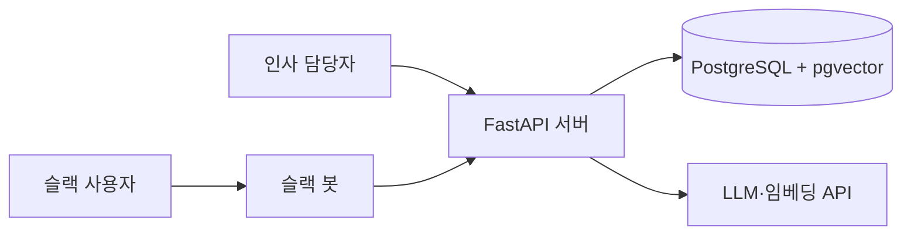

# 아키텍처

## 구성

## 구성 요소별 책임

| 구성 요소 | 책임 |
|---|---|
| `server/` `auth` 모듈 | 인증, 사용자 역할 확인, 허용 접근 등급 결정 |
| `server/` `documents` 모듈 | 문서 메타데이터 등록, 인덱싱 작업 생성 |
| `server/` `worker` 모듈 | 인덱싱 작업 조회, 파싱과 분할, 임베딩, 작업 상태 갱신 |
| `server/` `rag` 모듈 | 검색, 프롬프트 구성, 답변 생성, 대화 기록 |
| 슬랙 봇 (`bot/`) | 질문 수신, 서버 API 호출, 답변과 출처 표시 |
| PostgreSQL | 서비스 데이터와 벡터 저장 |

## 질문 처리 흐름

1. 슬랙 봇이 질문을 받아 서버 API로 전달한다.
2. `auth` 모듈이 사용자의 역할을 확인하고 허용된 접근 등급을 정한다.
3. `rag` 모듈이 질문을 임베딩하고, 접근 등급을 SQL 조건으로 걸어 검색한다.
4. 검색 점수가 기준 미만이면 LLM을 호출하지 않고 답변을 거절한다.
5. 기준을 넘으면 근거 조항으로 답변을 생성한다.
6. 답변, 출처, 응답 시간, 토큰 사용량을 저장하고 슬랙으로 보낸다.

## 문서 등록 흐름

1. 인사 담당자가 서버 API로 문서를 등록한다.
2. `documents` 모듈이 메타데이터를 저장하고 `PENDING` 상태의 인덱싱 작업을 만든 뒤 바로 응답한다.
3. `worker` 모듈이 `PENDING` 작업을 polling으로 가져가 `RUNNING`으로 바꾸고, 파싱, 분할, 임베딩을 수행한다.
4. 조각 저장에 성공하면 `DONE`으로, 실패하면 `FAILED`와 오류 메시지를 기록한다.

## 핵심 데이터 모델

| 테이블 | 주요 컬럼 |
|---|---|
| `documents` | 제목, 종류, 접근 등급, 버전, 시행일, 원문 경로 |
| `chunks` | 문서 ID, 장·조·항 경로, 본문, 임베딩, 접근 등급 |
| `users` | 슬랙 ID, 역할 |
| `conversations` | 사용자, 질문, 답변, 사용한 조각, 응답 시간, 토큰 수 |
| `ingestion_jobs` | 문서 ID, 상태, 오류 메시지, 시작·종료 시각 |

임베딩 차원은 1536이다. 임베딩 모델이나 차원을 바꾸면 전체를 다시 인덱싱한다.

## 기술 스택

사용하는 언어, 패키지, DB와 각각의 용도는 [README의 기술 스택](../README.md#기술-스택)에 있다.

## API

| 메서드 | 경로 | 권한 | 설명 |
|---|---|---|---|
| `GET` | `/health` | 없음 | 서버 상태 확인. `{"status": "ok"}`를 돌려준다 |

서버를 실행하면 `/docs`에서 FastAPI가 만든 API 문서를 볼 수 있다.

## 설계 결정

| 결정 | 이유 |
|---|---|
| 서버를 Python 하나로 구성 | [ADR 0001](adr/0001-single-python-service.md) |
| Gemini API의 LLM과 임베딩 모델 사용 | [ADR 0002](adr/0002-llm-and-embedding-models.md) |
| pgvector 사용 | 서비스 데이터와 벡터를 한곳에서 관리하고 권한 조건을 SQL로 함께 건다 |
| RAG 프레임워크 미사용 | 동작 원리를 직접 익히고 설명할 수 있게 한다 |
| 슬랙 Socket Mode 사용 | 공개 URL 없이 내 PC에서 개발할 수 있다 |
| 제공사 인터페이스 분리 | 무료 한도나 가격이 바뀌어도 교체할 수 있다 |

새로운 결정은 `docs/adr/`에 기록한다.
